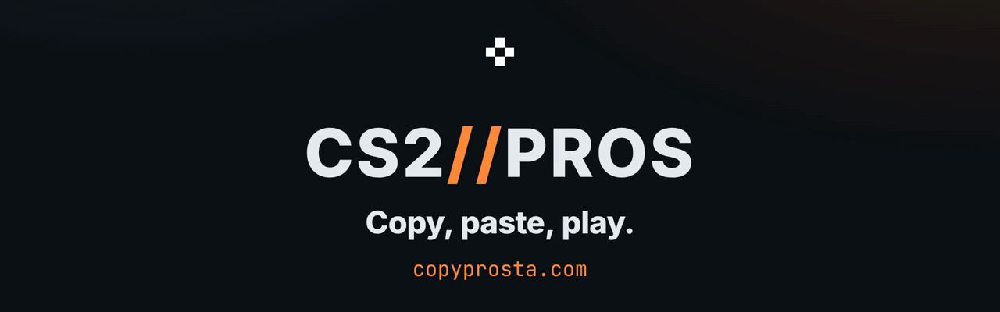

<div align="center">

<a href="https://copyprosta.com"></a>

# CS2 Pro Configs

**Browse CS2 pro players' full settings and copy ready-to-paste console commands to apply any pro's crosshair (converted to the new CS2 crosshair system), sensitivity, viewmodel, HUD and radar.**

[](https://copyprosta.com)
[](https://copyprosta.com)
[](https://github.com/AntonyPerez0/cs2-pro-configs/actions/workflows/update-data.yml)
[](LICENSE)

[**Open the site**](https://copyprosta.com) ·
[How to use](#how-to-use) ·
[Features](#features) ·
[How the crosshair conversion works](#the-crosshair) ·
[Run it locally](#updating-the-data)

<br>

https://github.com/user-attachments/assets/9e4f7a5b-64e6-4a02-bd1b-1c94435153d5

</div>

<br>

## How to use

1. Open a player page from the list on the site.
2. Hit **Copy crosshair**, a single section, or the **full config**, which comes in
   2–3 parts.
3. In CS2, open the console (`~` or `` ` `` key), paste, press Enter. For the full
   config, paste and Enter each part in turn.

> [!TIP]
> Or download the player's **.cfg**, save it in `Counter-Strike Global Offensive/game/csgo/cfg/` and run `exec <name>` in the console (for example `exec donk`). It holds the same converted commands, one per line.

> [!NOTE]
> Why parts: CS2 still ships the Source tokenizer, which rejects a console line longer than 510 characters ("…overflows the tokenizer buffer.. Skipping!"), and most pros' full configs are longer (up to about 1,200 characters). So the full config is split by section (crosshair; mouse, viewmodel & radar; HUD & other). Every copy button on the site is kept at 500 characters or less, and the build fails if one isn't.

## Features

- Search and sort across 620 pro players
- **HLTV Top 10 section** on the front page (latest official HLTV player ranking, links straight to each pro's config)
- **Classic configs** (`/classic/`): the top 10 players of each year from 2011 to 2015, plus Cloud9 and iBUYPOWER as they were in January 2015, with their dated CS:GO settings converted for CS2 and period photos (see below)
- **Your-DPI sensitivity matcher**: enter your mouse DPI once, get the in-game sensitivity that matches each pro's speed (eDPI match), or copy the config part with the sensitivity rewritten for your DPI
- Crosshair converted to the current CS2 crosshair system, with a pixel preview (inline SVG, works without JavaScript)
- Per-category copy blocks (crosshair, sensitivity, viewmodel, radar, HUD, other)
- Launch options for forcing resolution
- Downloadable, converted per-player `.cfg` file
- Fully prerendered static pages (one per player at `/p/<slug>/`), sitemap and structured data for search engines
- Weekly auto-refresh of data via a GitHub Action

## The crosshair

CS2's Sept 22, 2026 "Rush Hour" update replaced the crosshair system. Sizes are now
pixels at the resolution they were authored at (`cl_crosshair_screen_height`), and
the game rescales them to yours. The gap is measured from the centre. Later updates
added half outlines and a Static Square style (Sept 23) and outline colours and a
Static Quadrant style (Sept 30; dates UTC). Old share
codes (`CSGO-…`) no longer import, and `cl_crosshairgap`, `cl_crosshaircolor`,
`cl_crosshairusealpha`, `cl_crosshair_outlinethickness`,
`cl_crosshairgap_useweaponvalue` and `cl_fixedcrosshairgap` were removed.

settings.gg still lists the pros' **pre-patch** settings, so the site converts each
one. It uses a pinned copy of the community converter
[small-indie-crosshair-company](https://github.com/sebastianspicker/small-indie-crosshair-company)
(v0.19.1, model `community-static-v11`, CS2 build 2000922, crosshair cvars unchanged
through 2000930), vendored under `scraper/vendor/`:

- **Resolution:** each pro is converted at their own resolution, and
  `cl_crosshair_screen_height` is set to it, so the crosshair keeps the pixels the
  pro saw and scales proportionally on yours.
- **Outline:** off, half or full, depending on the old outline thickness.
  Black outline colour.
- **Opacity:** an old config with the alpha slider off gets opacity 255.
- **Styles 2 and 5:** they keep their family, since Valve kept both numbers. Style 2
  places its bars at the weapon's spread plus the gap, in the old game and in CS2
  (Valve allowed negative gaps for this style only on Sept 30, and two decompiles of
  the current client agree), so its gap is the old offset: the Static Cross gap minus
  4, which can be negative. A dot-only style 2 crosshair, which never moved, becomes a
  Static Cross. Style 5 rests at the old Legacy gap, `round(4 × height / 1200 + gap)`.
- **Colour:** old preset colours use the old game's RGB (green 50/250/50 and so on);
  an index other than 0-5 drew the default green and ignored the stored RGB, so it
  becomes green with a note.
- **Warnings:** dot-only, crossed-arm, weapon-gap and unusual-colour cases get a
  note on the player page.
- **Already new format:** if settings.gg ever lists a crosshair in the new format,
  it is copied as-is.
- **Complete pastes:** like a crosshair share paste (e.g. csstats.gg's), a paste
  sets every setting that shapes that crosshair, so nothing from the visitor's own
  crosshair carries over: colour, opacity, outline (and its colour when on), recoil,
  the iron-sight dot (`cl_ironsight_*`), and the settings CS2's crosshair menu
  shows for that style: the split cvars for style 2, the quadrant size
  (`cl_crosshair_dynamic_maxdist_splitratio`) for styles 2 and 9, and the spread
  limit for styles 0, 1 and 7. Values come from the pro's config, clamped to
  CS2's range, or else CS2's defaults (also for any core setting a new-format
  listing leaves out). Settings the menu hides for a style can't change it and
  are left out, which keeps most pastes to one console line (the console rejects
  lines over 510 characters; a longer paste comes in parts, with the size
  settings and screen height together in the last).

<details>
<summary><b>Accuracy: how the conversion was checked, and where a pro's current crosshair may differ</b></summary>

<br>

Valve published no conversion formula, so this is a community reconstruction. For
Static Cross (style 4) at 1920x1080 and 1280x960, its sizes agree with the rule
crosshairrestore.com measured from its owner's old- and new-game screenshots (builds
2000908 and 2000914, Sept 23, 2026; the screenshots aren't published). Those
captures predate the Sept 30 renderer change, and other styles and resolutions
haven't been checked against captures. Old sizes are rounded to the nearest pixel,
ties to even, as CS:GO's code did. For some pros, converting their old crosshair
gives the one seen in their matches after the update (demo-derived share codes on
procrosshairs.com, Oct 3-11, 2026): donk, xiELO, YEKINDAR and w0nderful at
length/thickness/gap 2/2/1, and FalleN at 3/2/0 with no outline. These are pinned
in `scraper/test_crosshair.mjs`. Not every pro matches. yuurih had the same old
settings as donk on settings.gg but used 2/2/0, and FL1T used 2/1/1 at 800p, where
the site converts his settings.gg values to 3/1/2 at 960p (2/1/2 at 800p). Others
(KSCERATO, who moved to Static Quadrant, Jame and molodoy) built a different
crosshair after the update. settings.gg's resolution can also be out of date: for
about a third of pros with post-update codes (113 of 345, Oct 2026), the code
records a different height than settings.gg lists. So a conversion of a pro's old
crosshair may differ from what they use now. Each player page says so and links
their crosshair history.

Other converters were compared on every pro and classic entry (Oct 2026). Where
they differ from this one, the cause is known: some leave out the half-thickness
term of the centre-measured gap (keymap.io, cstools.io and others draw the gap 1 px
smaller), use one fixed resolution or fixed factors, scale the gap with the
resolution, round ties up or truncate, export opacity 200 for an old config with the
alpha slider off, pass alpha above 255 through, use full-saturation preset colours,
give style 5 the Static Cross gap, or switch every outline fully on. crosshairrestore.com,
the only one with captures, gives the same crosshair for 286 of the 297 pros it
converts; the rest differ only where the old arms touched (gap -5) or in how a 1.5
outline is handled.

</details>

### Good to know

- **Mouse DPI / polling rate** are set in your mouse software, not the game. Make
  sure your driver matches the player's DPI shown on their page.
- **Video settings** (resolution, aspect ratio, stretched scaling) can't be applied via console. They're shown on each player page as manual tables, and the resolution can be forced with launch options.
- Every command is checked against CS2's own convar list (`scraper/cs2_convars.json`,
  from the game's convar dump): convars that don't exist in CS2 or are cheat-protected
  (`cl_radar_size`, `cl_drawhud`, `cl_mouselook`, `m_rawinput`, the removed crosshair
  convars, ...) are left out, renamed ones are renamed (`zoom_sensitivity_ratio_mouse`
  is `zoom_sensitivity_ratio`, `cl_righthand 0` is `cl_prefer_lefthanded 1`), and
  values outside the game's range are clamped as the game would. Each page lists
  what was adapted.
- Each page also shows the original settings.gg `autoexec.cfg` (pre-patch format,
  `cfg/raw/`). Don't exec it: its crosshair settings no longer work.

## Updating the data

- The workflow runs **weekly** automatically (scheduled via GitHub Actions).
- To trigger a manual refresh, go to the **Actions** tab in this repo and click **Run workflow**.
- Or run it locally (Python 3.10+ and Node 22.12+):

```bash
pip install -r scraper/requirements.txt
node scraper/test_crosshair.mjs         # conversion checks
python3 scraper/scrape.py               # refresh data/ and cfg/raw/ from settings.gg
python3 scraper/top10.py                # optional, usually blocked by HLTV
node scraper/crosshair.mjs              # convert crosshairs -> data/crosshair.json
python3 scraper/sitegen.py              # rebuild the HTML pages, cfg files and sitemap
python3 scraper/test_site.py            # check the result
```

To preview the site locally, serve the repo root (the pages use root-relative
links): `python3 -m http.server` and open http://localhost:8000.

<details>
<summary><b>Repo layout</b></summary>

<br>

```
.
├── index.html            # Player list page (generated)
├── p/<slug>/index.html   # One static page per player (generated)
├── classic/              # Classic section: /classic/ and /classic/<year>/<id>/ (generated)
├── player.html           # Redirect for old ?p=<slug> links (generated)
├── sitemap.xml, robots.txt, 404.html   # (generated)
├── assets/
│   ├── app.js            # Copy buttons, search/sort/filter, DPI matcher
│   ├── style.css         # Styles
│   └── og-default.png    # Social preview image
├── data/
│   ├── index.json        # Catalog of all players
│   ├── meta.json         # Dataset timestamp
│   ├── top10.json        # HLTV Top 10 list
│   ├── crosshair.json    # Converted crosshairs (generated by crosshair.mjs)
│   ├── classic.json      # Classic top 10s of 2011-2015 with dated, sourced configs (curated)
│   ├── players/<slug>.json  # Full per-player settings
│   ├── avatars/<slug>.webp  # Player avatars (settings.gg)
│   └── avatars/free/<slug>.webp  # Free photos for pros settings.gg has none for (credits: photos.json)
├── cfg/
│   ├── <slug>.cfg        # Converted config to exec (generated)
│   ├── classic/<id>-<year>.cfg  # Converted classic configs (generated)
│   └── raw/<slug>.cfg    # settings.gg's original autoexec.cfg (pre-patch format)
└── scraper/
    ├── scrape.py         # Scraper for settings.gg -> data/, cfg/raw/
    ├── top10.py          # Best-effort HLTV Top 10 refresh
    ├── crosshair.mjs     # Converts every crosshair -> data/crosshair.json (Node 22)
    ├── vendor/small-indie-crosshair-company/  # Pinned converter (MIT), see VENDORED.md
    ├── sitegen.py        # Builds every HTML page, cfg file, sitemap and robots.txt
    ├── cs2_convars.json  # CS2's player-settable convars with their ranges
    ├── tools/cs2_convars.py  # Rebuilds cs2_convars.json from a GameTracking-CS2 dump
    ├── test_crosshair.mjs   # Conversion checks on fixed inputs
    ├── test_site.py      # Checks on the generated site (run in CI before each commit)
    └── requirements.txt  # Python dependencies
```

The HTML pages and `cfg/<slug>.cfg` are generated: edit `scraper/sitegen.py` (or
`assets/`), not the generated files, then rebuild.

</details>

## Classic configs (2011-2015)

<details>
<summary><b>How the 2011-2015 configs were sourced, dated and converted</b></summary>

<br>

`data/classic.json` is curated by hand; the weekly run only re-converts it.

- **Rankings.** HLTV's Top 20 Players of the Year for 2011, 2013, 2014 and 2015 (first
  10 places). HLTV published no ranking for 2012, the year CS:GO replaced CS 1.6, so
  2012 lists the top CS:GO prize-money earners of that year from
  [Esports Earnings](https://www.esportsearnings.com/history/2012/games/245-counter-strike-global-offensive),
  which ranks by money, not skill. Its 9th and 10th places couldn't be verified, so
  2012 has 8 players.
- **Lineups.** Cloud9 (n0thing, seang@res, shroud, Semphis, ShahZaM) and iBUYPOWER
  (AZK, DaZeD, Hiko, Skadoodle, swag) in January 2015, at `/classic/c9-ibp-2015/`,
  with steel listed alongside iBUYPOWER (he had left in November 2014). A lineup group
  has `"kind": "roster"`, its own `key`, `when` and `target` month; players have a
  `team` instead of a rank, and a player who had left by then has a `standing`.
- **Configs.** 2011 was a CS 1.6 ranking, so those players get their CS:GO settings.
  Each entry uses the player's config closest to the ranking year that can be
  converted, mostly game-written `config.cfg` files from setup.gg's public archive,
  plus Liquipedia's settings tables. A date comes from the settings a file contains,
  checked against Valve's release notes (a setting added on a known date bounds when
  the file was saved), from a date written in the file or on its source (a header
  comment, Liquipedia's "Updated as of"), or else from the archive's commit date as an
  upper bound. Every page shows the date, its source and how the date is known. When
  the crosshair, sensitivity and resolution come from different configs, the page says
  which part is from when. DPI is only paired with a sensitivity from a config with
  the same sensitivity, so the eDPI never mixes eras; when no such DPI exists, the DPI
  matcher assumes the one in the player's setup.gg profile (`dpi_hint`), says so, and
  lets the visitor change it. A crosshair is converted at the resolution its own
  source gives. Two players (trace 2011, Gux 2011) have no documented CS:GO config and
  are listed without one. swag only ever used crosshair style 1, which can't be
  converted, so his page says so.
- **Conversion.** The same converter as the current players. Crosshair settings
  CS:GO added later are set to what the player had then, not CS2's defaults:
  `cl_crosshair_drawoutline` (added 22 May 2013), `cl_crosshairgap_useweaponvalue`
  (1 Aug 2014, off by default), `cl_crosshair_t` (26 Sep 2017) are off when the config
  predates them, `cl_crosshairgap_useweaponvalue` and `cl_crosshair_t` are off when a
  later config doesn't set them, and `cl_crosshair_recoil` is off (cheat-protected in
  CS:GO). A config from after 22 May 2013 that doesn't set the outline gets it on with
  width 1, CS:GO's default, and an outline width below CS:GO's minimum of 0.1 is drawn
  at 0.1 (the half outline). Before 5 Jun 2013 the style 4 gap changed per weapon,
  which the page notes. Before 12 Feb 2014 style 2 widened when firing but didn't show
  weapon accuracy, like style 5, so it is exported as style 5. CS:GO accepted styles
  above 5 (GuardiaN used 6) and drew them like style 5, so they convert as style 5
  with a note.

- **Photos.** Each player's card and page show a freely licensed photo from Wikimedia
  Commons or Flickr (CC BY, CC BY-SA, CC0 or public domain) taken as close as possible
  to the entry's time (a later one when none from then exists), cropped to
  `data/avatars/classic/<id>-<key>.webp` and credited on the page and in /classic/'s
  photo credits (a player's `photo` in `data/classic.json`). Players with no free photo
  keep the letter circle. These crops are not covered by
  this repository's licence: each stays under its own Commons file's licence, as
  credited.

Optional config fields: `window` (first and last day the file can be from) narrows
the era rules above, and `crosshair_resolution` is the resolution the crosshair is
converted at when its source differs from the video settings shown.

To change an entry, edit `data/classic.json`, then run `node scraper/crosshair.mjs`,
`python3 scraper/sitegen.py` and `python3 scraper/test_site.py`.

</details>

## Data source & credits

All settings data is sourced from [settings.gg](https://settings.gg) (community-generated pro configs). Classic section: rankings from [HLTV](https://www.hltv.org) and [Esports Earnings](https://www.esportsearnings.com), configs from the public archives linked on each page. Crosshair conversion: [small-indie-crosshair-company](https://github.com/sebastianspicker/small-indie-crosshair-company) (MIT). This project is an unofficial, fan-made convenience tool and is **not** affiliated with settings.gg, Valve, or any player. Data is updated weekly.

## Disclaimer

This project is for personal use only. Settings accuracy depends on contributions to settings.gg.

<div align="center">

<br>

**[copyprosta.com](https://copyprosta.com)** · MIT licensed · Not affiliated with Valve or settings.gg

</div>
